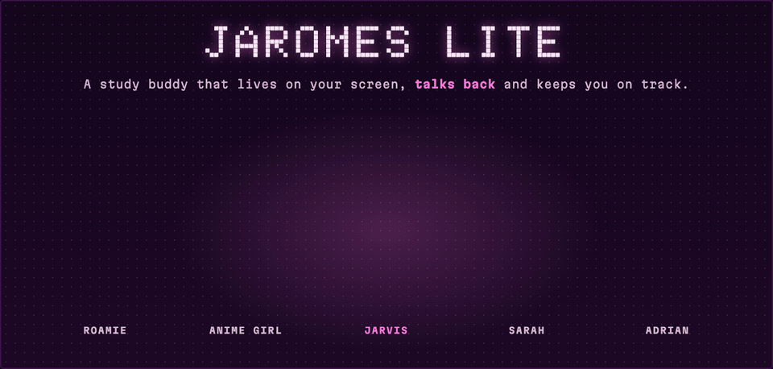
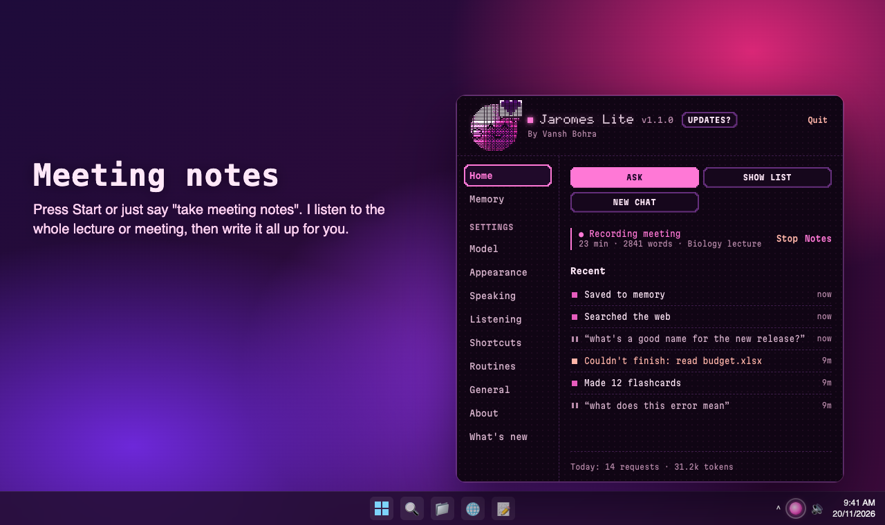
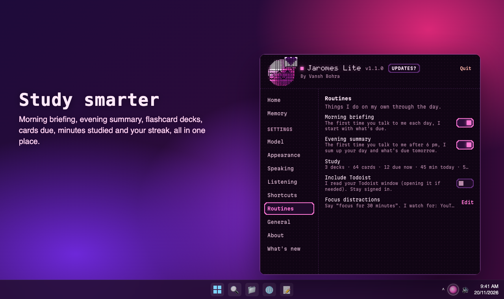
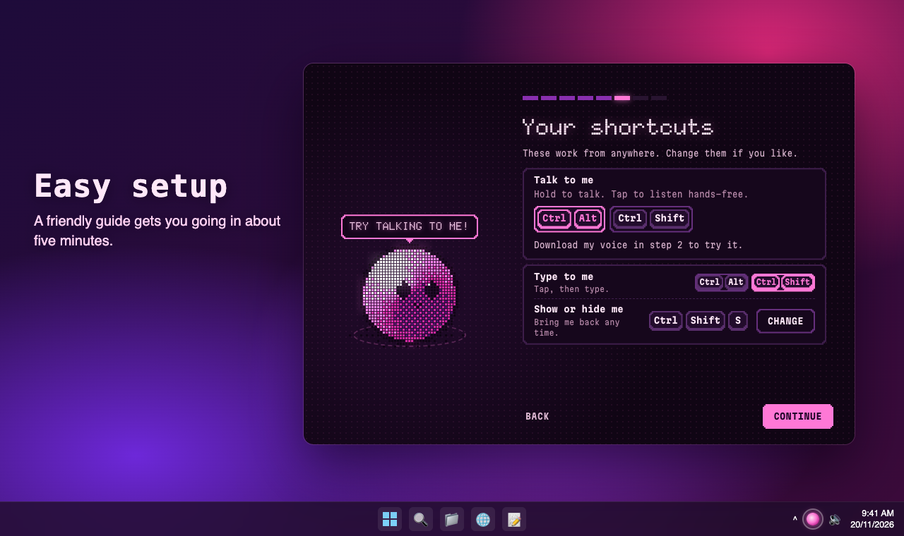
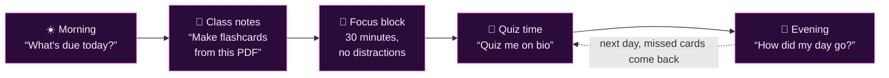
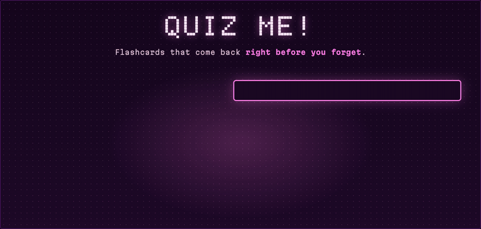
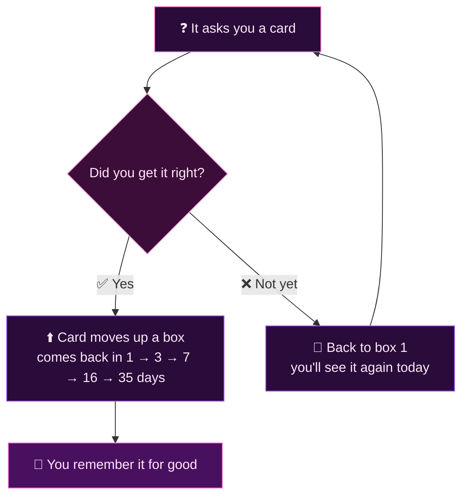
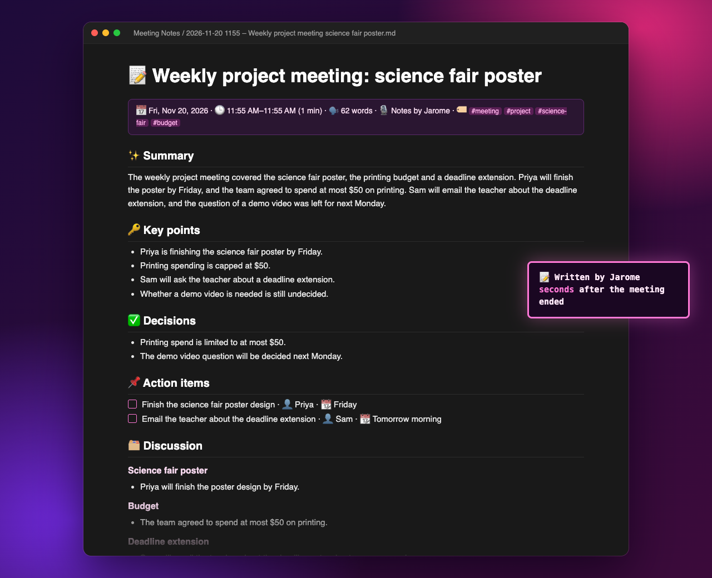

<p align="center">
  
</p>

<p align="center">
  <b>A friendly pixel buddy for your Windows that you can talk to.</b><br>
  It keeps your reminders, quizzes you before tests, tells you how your day went,<br>
  and does the boring computer stuff while you get on with the important things.
</p>

<p align="center">
  
  
  
</p>

<p align="center">
  🍎 On a Mac? → <a href="https://github.com/Vanshworkff/jaromes-lite-mac">jaromes-lite-mac</a>
  &nbsp;·&nbsp;
  🪟 On Windows? → <a href="https://github.com/Vanshworkff/jaromes-lite-windows">jaromes-lite-windows</a>
</p>

---

## 📸 Take a look

<p align="center">
  
</p>
<table>
  <tr>
    <td width="50%"></td>
    <td width="50%"></td>
  </tr>
  <tr>
    <td align="center"><b>📚 Study stats and routines</b></td>
    <td align="center"><b>🧭 A friendly setup guide</b></td>
  </tr>
</table>

<sub>Real Jaromes Lite screens, shown with sample data.</sub>

---

## 👋 Meet your buddy

Jaromes Lite lives in your **system tray (bottom right, next to the clock; it may hide behind the ^ arrow)**. Hold two keys, say what you need, let go. That's it.

```
        ┌───────────────────────────────┐
        │  "Quiz me on chemistry" 🎙️    │      you hold Ctrl + Alt
        └──────────────┬────────────────┘      and just talk
                       ▼
                  ( ◕‿◕ )  ✨
                       │
        ┌──────────────▼────────────────┐
        │  "Okay! Question 1: what is   │      it answers out loud,
        │   the charge of an electron?" │      like a friend would
        └───────────────────────────────┘
```

You don't need to be "good with computers". If you can talk, you can use it. 💜

---

## ✨ What it can do

| | | |
|:---:|---|---|
| 🧑‍🎓 | **Meet Jarome** | Our very own study buddy: spiky hair, headphones, round glasses and a lot of hype. Or pick one of 8 other looks, each with its own voice **and personality**: a calm butler, a sassy secretary, a deadpan lab AI, a bubbly anime girl and more. |
| 🎙️ | **Talk or type** | Ask anything by voice or keyboard. It answers in a short, friendly way, and can even search the web for you. |
| ⏰ | **Reminders & to-dos** | *"Remind me to call Mum at 6"*. It remembers, nudges you on time, and cheers when you finish. |
| ☀️ | **Morning briefing** | The first time you talk each day, it tells you what's on today. |
| 📚 | **Flashcards** | *"Make flashcards from my biology PDF"*. It reads your notes and saves the cards in decks. |
| 🧠 | **Smart quizzes** | *"Quiz me on bio"*. Cards you get right come back later; ones you miss come back soon (spaced repetition). |
| 📄 | **Reads your PDFs** | Lecture slides, worksheets, textbook chapters: it explains, sums up or turns them into cards. |
| 📝 | **Meeting notes** | *"Take meeting notes"*. It listens to the whole meeting or lecture, then writes a Notion-style page: summary, decisions, action items with owners, and the full transcript. |
| 🎯 | **Focus timer** | *"Help me focus for 30 minutes"*. It gently teases you back if you wander off to YouTube. |
| 🌙 | **Evening summary** | After 6 pm it tells you what you got done, how long you studied, your streak, and what's due tomorrow. |
| 🖱️ | **Works your apps** | Fills in forms, clicks buttons, opens apps and files, and runs commands, always **asking first** before changing anything. |
| 🔄 | **Updates itself** | When a new version is out, an **Update** button appears in the panel. One click and you're on the latest. |
| 🤖 | **Background agents** | *"Make me a study timetable website"*. A helper works on it in the background while you keep chatting. |

---

## 🔁 How a study day looks



### 🧠 How the flashcards learn with you

<p align="center">
  
</p>



---

## 🚀 Get started (about 5 minutes)

**You need:** Windows 10 or 11 (64-bit), and an AI account to give your buddy a brain: a **Claude** plan, a **ChatGPT** plan, or an API key from Anthropic, OpenAI or Google. The setup guide walks you through it.

### 1. Download 📦

Go to **[Releases](../../releases)** and download **`Jaromes-Lite_…_windows-x64-setup.exe`**.

### 2. Run the installer 🖱️

```
   ┌───────────────────────────────────────────┐
   │  Windows protected your PC                │
   │                                           │
   │  [ More info ]   ◀── 1. click this         │
   │                                           │
   │              [ Run anyway ] ◀── 2. then    │
   └───────────────────────────────────────────┘
```

Jaromes Lite is a free, open-source app without a paid Microsoft certificate, so Windows SmartScreen asks you to confirm once. Click **More info**, then **Run anyway**. The installer sets everything up for your user only; no admin password needed.

### 3. Find your buddy 🔍

Look in the **system tray** at the bottom right, next to the clock. If you don't see it, click the little **^** arrow, then drag the Jaromes Lite icon onto the taskbar so it stays in view. 🎉

### 4. Say hi! 👋

The setup guide opens by itself. It helps you pick your buddy's look and voice, and sign in to your AI account.

When it asks, allow the **microphone** (so it can hear you). Speech is turned into text right on your PC; the first time, it downloads a small speech model.

Then hold **<kbd>Ctrl</kbd> + <kbd>Alt</kbd>**, say *"Hi!"*, and let go. 🎉

---

## ⌨️ Handy shortcuts

| Do this | Press |
|---|---|
| 🎙️ Talk | Hold <kbd>Ctrl</kbd> + <kbd>Alt</kbd>, speak, let go |
| ⌨️ Type a question | Tap <kbd>Ctrl</kbd> + <kbd>Alt</kbd> quickly (press both, let go) |
| 👀 Show or hide your buddy | <kbd>Ctrl</kbd> + <kbd>Shift</kbd> + <kbd>S</kbd> |
| 📋 See your reminders | <kbd>Ctrl</kbd> + <kbd>Shift</kbd> + <kbd>L</kbd> |

You can change them in the panel: click the icon in the system tray → **Settings**.

---

## 💬 Things to try

> 🎙️ *"Make 10 flashcards about photosynthesis, then quiz me."*
>
> 🎙️ *"Read the PDF called chapter 3 in my Downloads and tell me the main ideas."*
>
> 🎙️ *"Remind me to revise maths every weekday at 5."*
>
> 🎙️ *"Focus for 45 minutes on my essay."*
>
> 🎙️ *"Take notes of this lecture."* … then *"Stop the meeting notes."*
>
> 🎙️ *"How did my day go?"*
>
> 🎙️ *"What's the weather in London tomorrow?"*

Every small step counts. Five minutes of flashcards today beats a three-hour cram tomorrow. You've got this! 💪💜

---

## 📝 Meeting notes, like Notion

```
  "Take meeting notes" 🎙️  ──▶  ( ◕‿◕ ) listening…  ──▶  "Stop the meeting notes"  ──▶  📄 your notes open
```

<p align="center"></p>

1. Say **"take meeting notes"** (or press **Start** under *Meeting notes* on the panel's Home page).
2. Have your meeting, class or call. Jaromes Lite keeps listening and writing everything down, on your computer.
3. Say or type **"stop the meeting notes"** (or press **Stop**). A minute later your notes open: **summary, key points, decisions, action items with owners and dates, topics, open questions** and the **full transcript** with timestamps.

Notes are saved as Markdown pages in **Documents → Meeting Notes**, so they open anywhere and import straight into **Notion** (*Import → Markdown*). 🙋 If other people are in the meeting, let them know you're taking notes.

---

## 🔄 Staying up to date

```
   new version on GitHub  ──▶  ( ◕‿◕ ) "Update to 1.0.1"  ──▶  click  ──▶  ✨ restarted, all set
```

Jaromes Lite checks this repo's **[latest release](../../releases/latest)** on its own. When there's something new, the button at the top of its panel turns into **Update to …**. Click it and it downloads, installs and restarts by itself. Your reminders, flashcards and settings stay just as they were. Every update is **digitally signed**, so your buddy only installs real ones from this repo.

---

## 🔒 Safe by design

- 🙋 **It asks before it acts.** Changing files, running commands and clicking things in apps all need your **yes** (and are off until you switch them on).
- ✉️ **Nothing gets sent in your name** without you seeing the exact text first.
- 🗝️ **Your keys stay on your computer**, in the Windows encrypted store.
- 🏠 **Your reminders, flashcards and memory** are saved on your computer only.
- 🙈 **Lite edition:** it never looks at or draws on your screen.

---

## 🛠️ Build it yourself (for developers)

Easiest: let GitHub build it for you. Open the **Actions** tab → **Build Windows app** → **Run workflow**. In about 20 minutes the installer appears under that run's **Artifacts**. ✨

Or on a Windows PC with [Git Bash](https://git-scm.com), [Node.js 22+](https://nodejs.org), [Rust](https://rustup.rs) and the Visual Studio C++ build tools:

```bash
cargo install tauri-cli --version "^2" --locked
git clone https://github.com/Vanshworkff/jaromes-lite-windows.git
cd jaromes-lite-windows/showcase/tauri/sidecar && npm ci && cd ..
TAURI_BUNDLES=nsis ./build.sh release --target x86_64-pc-windows-msvc
# → src-tauri/target/x86_64-pc-windows-msvc/release/bundle/nsis/
```

Pushing a tag like `v1.0.1` makes GitHub build the Windows installer, publish a release, and post the signed update that installed copies pick up (see `.github/workflows/`). Bump `version` in `showcase/tauri/src-tauri/tauri.conf.json` to match the tag first. The update signing key lives in the repo's `TAURI_SIGNING_PRIVATE_KEY` secret.

---

## 💜 Credits

**Jaromes Lite is created by Vansh Bohra.**

It's built on the open-source **[Roamies](https://github.com/KenKaiii/Roamies)** desktop companion by Ken Kai. Thank you for sharing it with the world! Third-party parts and their licenses are listed in [THIRD_PARTY_NOTICES.md](THIRD_PARTY_NOTICES.md).

## 📜 License

[GNU AGPL-3.0](LICENSE), the same as Roamies. You're free to use, change and share it; if you share a changed version, share its source code too. 🤝

<p align="center"><sub>Made with 💜 by Vansh Bohra</sub></p>
